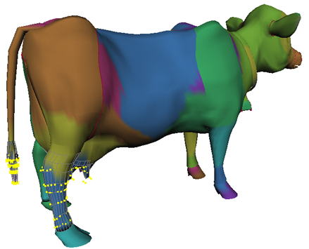

# 绘制刚性蒙皮点集成员身份

 <!-- baize:img-hook downloaded=true reason="正文 261 字 <300 且带图" -->

可以按绘制变形器集成员身份的相同方式来绘制刚性蒙皮点集成员身份。有关更详细的信息，请参见[绘制变形器集成员身份](../../../../变形效果/变形效果/变形器成员身份/使用“编辑成员身份工具”%28Edit%20Membership%20Tool%29编辑变形器集成员身份/绘制变形器集成员身份.md)。

## 操纵关节晶格屈肌的影响晶格

您可以以操纵晶格变形器的影响晶格的相同方式来操纵关节晶格屈肌的影响晶格。可以移动、旋转或缩放晶格，也可以移动、旋转或缩放晶格点。

## 操纵骨骼晶格屈肌的影响晶格

您可以以操纵晶格变形器的影响晶格的相同方式来操纵骨骼晶格屈肌的影响晶格。可以移动、旋转或缩放晶格，也可以移动、旋转或缩放晶格点。

## 编辑关节或骨骼雕刻屈肌效果

### 操纵雕刻球体

可以按操纵雕刻变形器的雕刻球体的相同方式来直接操纵屈肌的雕刻球体。
