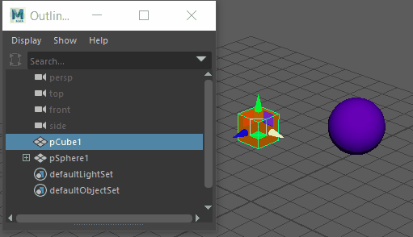
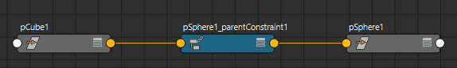

# 删除约束

在大纲视图中删除约束

1. 打开[大纲视图](https://beehive.autodesk.com/community/service/rest/cloudhelp/resource/cloudhelpchannel/guidcrossbook/jsonp?v=2022&p=MAYAUL&l=CHS&accessmode=live&guid=GUID-4B9A9A3A-83C5-445A-95D5-64104BC47406)。

2. 展开受约束对象并选择约束。

3. 按 **Delete** 键。

 <!-- baize:img-hook downloaded=true reason="正文 169 字 <300 且带图" -->

在节点编辑器中删除约束

1. 打开[节点编辑器(Node Editor)](https://beehive.autodesk.com/community/service/rest/cloudhelp/resource/cloudhelpchannel/guidcrossbook/jsonp?v=2022&p=MAYAUL&l=CHS&accessmode=live&guid=GUID-23277302-6665-465F-8579-9BC734228F69)。

2. 选择约束节点。

  您可以选择约束选择控制柄（如果显示），或使用“Hypergraph”或其他节点编辑器选择约束节点。

3. 按 **Backspace**、**Delete** 键，或选择“编辑 > 删除”(Edit > Delete)。

 <!-- baize:img-hook downloaded=true reason="正文 169 字 <300 且带图" -->
