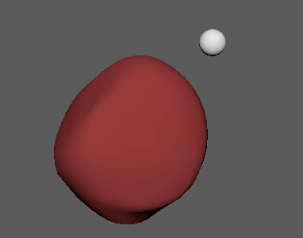

# 多边形上的点约束

 <!-- baize:img-hook downloaded=true reason="正文 137 字 <300 且带图" -->

通过多边形上的点约束，可以将对象约束到网格，以便在网格变形时受约束对象贴附于曲面上的某个点。您可以将对象约束到整个网格，也可以约束到特定的顶点、面或边。使用该约束可以创建各种效果，例如外套变形时外套上的纽扣仍保留在原位。

## 相关主题

- [pointOnPolyConstraint 节点](https://help.autodesk.com/cloudhelp/2022/CHS/Maya-CharacterAnimation/files/GUID-D59BE75D-7CB8-4A20-ACB2-B205BFD5D6DC.htm)
