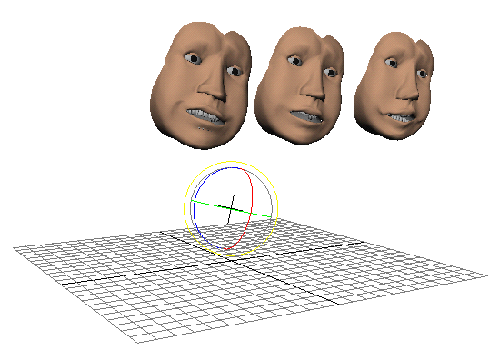

# 方向约束

方向约束将一个对象的方向与一个或多个其他对象相匹配。此约束可用于同时确定几个对象的方向。例如，为一个角色的头部设置动画，然后根据刚刚设置动画的头部约束所有其他角色的头部，可以使一组角色同时朝向同一方向。

请参见[创建方向约束(Create orient constraints)](https://help.autodesk.com/cloudhelp/2022/CHS/Maya-CharacterAnimation/files/GUID-392F86AF-CDBC-4071-9255-E8EAB921D77A.htm)和[约束 > 方向(Constrain > Orient)](https://help.autodesk.com/cloudhelp/2022/CHS/Maya-CharacterAnimation/files/GUID-43481AAA-0513-4C02-8CE6-FAF5D0BEF96E.htm)。

 <!-- baize:img-hook downloaded=true reason="正文 160 字 <300 且带图" -->
