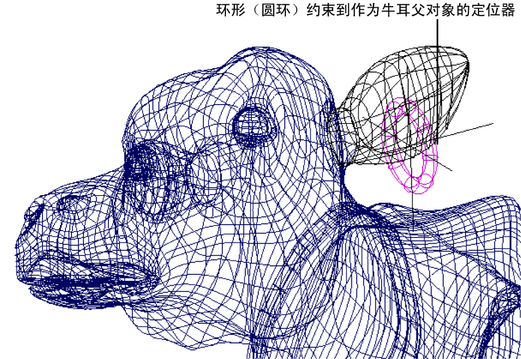

# 点约束

点约束使对象向着并跟随对象的位置或者几个对象的平均位置而移动。此功能用于使一个对象匹配其他对象的运动。

也可以使用点约束对一个对象进行动画设置，使其跟随其他一系列的对象。

请参见[创建点约束(Create point constraints)](https://help.autodesk.com/cloudhelp/2022/CHS/Maya-CharacterAnimation/files/GUID-DAE54462-3F5B-4F5E-B038-9482491B5429.htm)和[约束 > 点(Constrain > Point)](https://help.autodesk.com/cloudhelp/2022/CHS/Maya-CharacterAnimation/files/GUID-BB0B5F46-2BB7-4EA0-A611-27759EBA6609.htm)。

 <!-- baize:img-hook downloaded=true reason="正文 139 字 <300 且带图" -->
