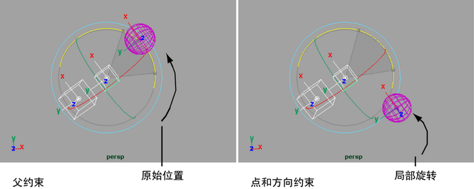

# 父约束

使用父约束，您可以相关一个对象的位置—平移和旋转到另一个对象，以便这些对象的行为就像具有多个目标父对象的父-子关系。对象的移动也会受多个对象平均位置的影响。

当父约束被应用到一个对象时，受约束对象不会成为约束对象的层次或组的一部分，而是保持独立，同时表现得像是目标的子对象一样。约束对象也称为目标对象。

带父约束的对象不会表现得象带点和方向约束的对象那样。当使用了父约束后，旋转目标对象将影响受约束对象沿世界轴的旋转。当使用了点和方向约束后，旋转目标对象将影响受约束对象沿其局部轴的旋转。如下图所示。

 <!-- baize:img-hook downloaded=true reason="正文 296 字 <300 且带图" -->

## 相关主题

- [创建父约束](https://help.autodesk.com/cloudhelp/2022/CHS/Maya-CharacterAnimation/files/GUID-2FC0EE9E-A8D5-4B2A-A751-8B926389497A.htm)

- [约束 > 父对象(Constrain > Parent)](https://help.autodesk.com/cloudhelp/2022/CHS/Maya-CharacterAnimation/files/GUID-093A13E1-5DF1-454B-B5D3-BCAA5427B51A.htm)

- [约束(Constraints)](../约束.md)
