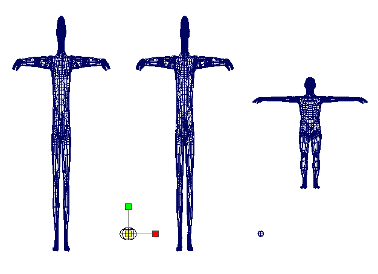

# 缩放约束

缩放约束可以将一个缩放对象与另外一个或多个对象相匹配。该约束在同时缩放多个对象时非常有用。例如，可以通过为一个字符的头制作动画，然后将其他所有字符的头约束为您已制作动画的头，从而同时将一组字符全部都设置为相同方向。

受约束对象是指其缩放受一个或多个目标对象的缩放驱动的对象。一个或多个目标对象的缩放称为目标缩放。

请参见[创建缩放约束](https://help.autodesk.com/cloudhelp/2022/CHS/Maya-CharacterAnimation/files/GUID-8105CBE5-D3F3-4848-AD0C-62DD2C113509.htm)和[缩放约束选项](https://help.autodesk.com/cloudhelp/2022/CHS/Maya-CharacterAnimation/files/GUID-CD49C0AF-F683-44E2-8A49-AC19FDC32A1A.htm)。

 <!-- baize:img-hook downloaded=true reason="正文 172 字 <300 且带图" -->
