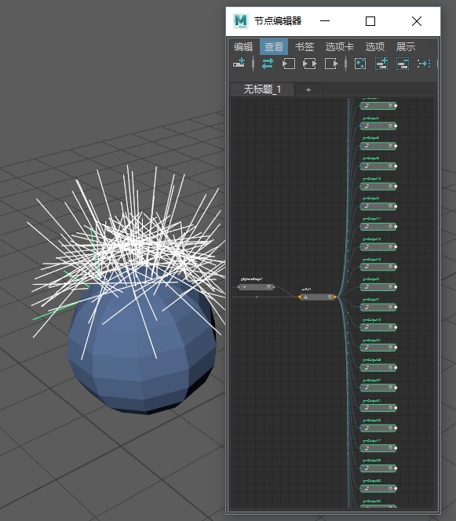

# 铆钉(Rivet)

 <!-- baize:img-hook downloaded=true reason="正文 296 字 <300 且带图" -->

通过“铆钉”(Rivet)命令，只需在场景中选择面、点或 UV，即可轻松创建直接附加到变形网格的定位器。

这些节点尤其适用于将道具添加到角色等任务，例如，在衬衫上粘贴纽扣，或将勋章附加到制服上。有关如何使用铆钉(Rivet)将定位器附加到几何体的说明，请参见[创建铆钉](https://help.autodesk.com/cloudhelp/2022/CHS/Maya-CharacterAnimation/files/GUID-AA022E34-2D7A-4055-A827-66838221D61B.htm)。

“铆钉”(Rivet)命令可快速创建 [uvPin 节点](矩阵运算符/UV%20固定%28UV%20Pin%29.md)，从而在初始设置中更好地进行控制。创建铆钉后，[节点编辑器(Node Editor)](https://beehive.autodesk.com/community/service/rest/cloudhelp/resource/cloudhelpchannel/guidcrossbook/jsonp?v=2022&p=MAYAUL&l=CHS&accessmode=live&guid=GUID-23277302-6665-465F-8579-9BC734228F69)中将显示 uvPin 节点。下图显示了一个铆钉及其在“节点编辑器”(Node Editor)中对应的节点。单个 uvPin 节点可以表示多个节点，从而可以即时修改此“主节点”。

 <!-- baize:img-hook downloaded=true reason="正文 296 字 <300 且带图" -->

单个 UV 固定节点可以表示多个节点
