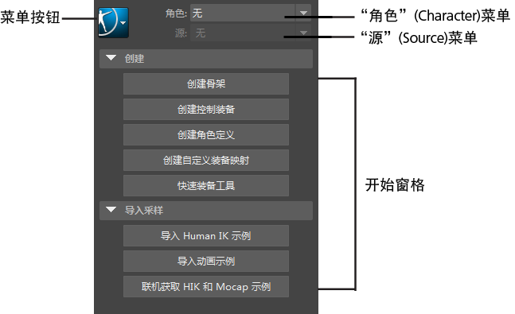

# “HumanIK”窗口

- 骨架 > HumanIK (Skeleton > HumanIK)

- 窗口 > 动画编辑器 > HumanIK (Window > Animation Editors > HumanIK)

- 单击 HumanIK 图标  <!-- baize:img-hook downloaded=true reason="正文 179 字 <300 且带图" -->

使用此工具，您可以在单个窗口中执行多个角色设置任务。HumanIK 窗口具有以下主要区域：

- [菜单按钮](https://help.autodesk.com/cloudhelp/2022/CHS/Maya-CharacterAnimation/files/GUID-847A8632-2621-487E-A8E1-8A0E6340973A.htm)

- [“角色”(Character)菜单](https://help.autodesk.com/cloudhelp/2022/CHS/Maya-CharacterAnimation/files/GUID-46964B80-1DEA-49BB-A7CF-0DBA40D9F87F.htm)

- [“源”(Source)菜单](https://help.autodesk.com/cloudhelp/2022/CHS/Maya-CharacterAnimation/files/GUID-AD727276-1FE1-4F84-9746-DF3CAB994F96.htm)

- [“开始”(Start)窗格](https://help.autodesk.com/cloudhelp/2022/CHS/Maya-CharacterAnimation/files/GUID-708BB8DD-C29F-4112-8704-730716E538C9.htm)

 <!-- baize:img-hook downloaded=true reason="正文 179 字 <300 且带图" -->
