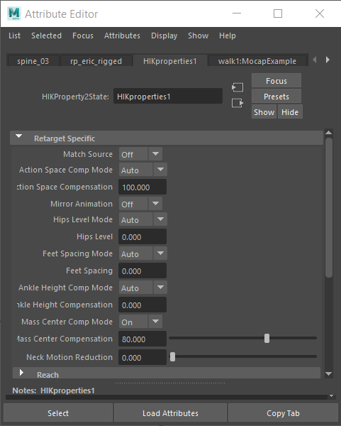

# HumanIK 属性

可以在[属性编辑器(Attribute Editor)](https://beehive.autodesk.com/community/service/rest/cloudhelp/resource/cloudhelpchannel/guidcrossbook/jsonp?v=2022&p=MAYAUL&l=CHS&accessmode=live&guid=GUID-67A58D31-4722-4769-B3E6-1A35B5B53BED) **的“HIKProperties”**选项卡中为选定角色设置特定特性。通过“重定目标”(Retargeting)和“解算”(Solving)特性以及“角色刚度”(Character Stiffness)、“达到”(Reach)、“拉动”(Pull)和“地板接触”(Floor Contact)属性，这些设置使您可以精确控制各种角色特性。

 <!-- baize:img-hook downloaded=true reason="正文 235 字 <300 且带图" -->

“HIKProperties”选项卡的“重定目标特定”(Retarget Specific)区域
