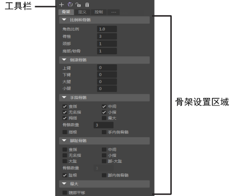

# “骨架”(Skeleton)选项卡

打开骨架(Skeleton)选项卡

- 打开 [HumanIK 窗口](../“HumanIK”窗口.md)（“骨架 > HumanIK”(Skeleton > HumanIK)），然后选择顶部的“骨架”(Skeleton)选项卡。

此选项卡用于创建 HumanIK 角色的骨架。“骨架”(Skeleton)选项卡具有以下主要区域：

- [“骨架”(Skeleton)选项卡工具栏](https://help.autodesk.com/cloudhelp/2022/CHS/Maya-CharacterAnimation/files/GUID-3C8150E8-B3C3-490F-A4E0-E96F95D4E263.htm)

- [骨架设置区域](https://help.autodesk.com/cloudhelp/2022/CHS/Maya-CharacterAnimation/files/GUID-3DF80458-E953-4EA8-AE8E-A73627419F1A.htm)

 <!-- baize:img-hook downloaded=true reason="正文 159 字 <300 且带图" -->
