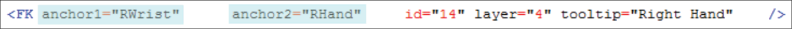
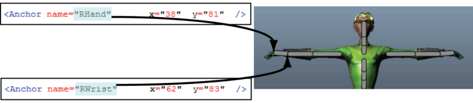

# 在 HumanIK“自定义绑定”(Custom Rig)界面上重新定位效应器

调整效应器的位置的步骤

1. 查找要在配置文件中调整的效应器的名称，并找到其定位点。以下示例中的 FK 效应器具有两个定位点，名称分别为 RWrist 和 RHand。

   <!-- baize:img-hook downloaded=true reason="正文 194 字 <300 且带图" -->

  每个 <Anchor> 元素都有一组自己的 X 和 Y 坐标，与布局上的位置相对应。

2. 更改定位点的坐标以适合工作流或动画绑定。以下示例显示了 RHand 和 RWrist 在“自定义绑定”(Custom Rig)布局中的位置。

   <!-- baize:img-hook downloaded=true reason="正文 194 字 <300 且带图" -->

## 相关主题

- [自定义 HumanIK 角色界面](../../自定义%20HumanIK%20角色界面.md)
