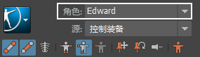

# 角色(Character)菜单

 <!-- baize:img-hook downloaded=true reason="正文 242 字 <300 且带图" -->

可以在场景中从角色列表中选择并显示活动角色的名称。

可从下列选项中选择：

#### 无(None)

场景中没有 HumanIK 角色时显示。

**注**

可以随时选择此选项以返回到

“开始”(Start)窗格

。

#### 字符

将当前角色设置为选定的 HumanIK 角色。按名称列出角色。

**注**

如果角色具有自定义装备映射，则角色的名称显示为

<CharacterName>（自定义装备）

。

## 相关主题

- [“控制”(Controls)选项卡](“控制”%28Controls%29选项卡.md)

- [“定义”(Definition)选项卡](“定义”%28Definition%29选项卡.md)

- [“自定义装备”(Custom Rig)选项卡概述](“自定义装备”%28Custom%20Rig%29选项卡.md)

- [设置 HumanIK 角色](../../../../HumanIK/HumanIK/设置%20HumanIK%20角色.md)
