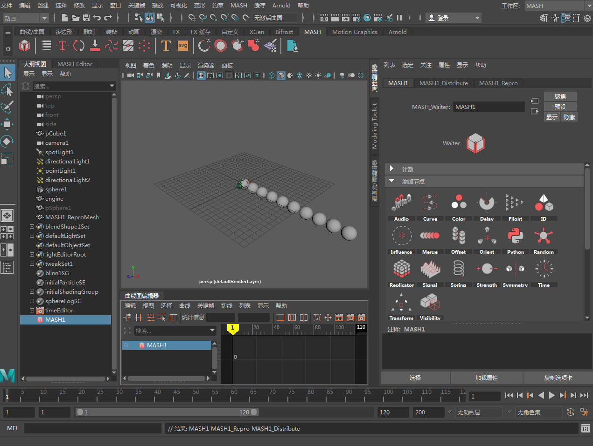

# MASH 工作区

MASH 工作区可排列界面，使您能够快速访问相关程度最高的工具和适用于 MASH 工作流的编辑器。有关详细信息，请参见[工作区](https://beehive.autodesk.com/community/service/rest/cloudhelp/resource/cloudhelpchannel/guidcrossbook/jsonp?v=2022&p=MAYAUL&l=CHS&accessmode=live&guid=GUID-0384C282-3CA1-4587-9775-F7164D3F6980)。

若要切换到 MASH 工作区，请转到“窗口 > 工作区 > MASH”(Windows > Workspaces > MASH)，或者从界面右上角的“工作区”(Workspace)下拉菜单中选择“MASH”。

 <!-- baize:img-hook downloaded=true reason="正文 154 字 <300 且带图" -->
