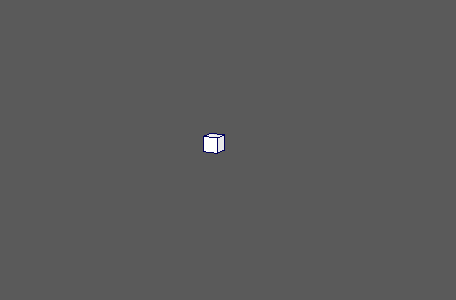

# 弹簧

 <!-- baize:img-hook downloaded=true reason="正文 281 字 <300 且带图" -->

向现有动画添加弹簧。因此，需要已设置动画的 MASH 节点输入。

## MASH 弹簧(MASH Spring)

#### 弹簧强度(Spring Strength)

确定节点的整体效果。

#### 最大平移(Maximum Translational)

确定弹簧效果的范围。 此值越大，对象在弹簧作用下移动的距离越远。

#### 阻尼(Damping)

抑制弹簧效果。较高的值会导致弹簧更快速地稳定下来。

#### 刚度(Stiffness)

确定弹簧效果的刚性。较小的值会导致更大的重叠。

#### 阻尼变化(Damping Variation)

逐对象添加随机变化的阻尼值。

#### 刚度变化(Stiffness Variation)

逐对象添加随机变化的刚度值。
