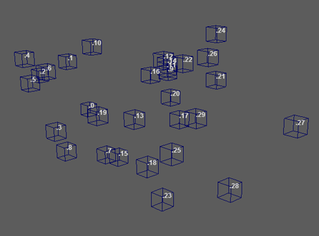

# 点

 <!-- baize:img-hook downloaded=true reason="正文 164 字 <300 且带图" -->

逐点显示各种类型的信息。若要使用此节点，请选择 [Waiter](../Waiter.md)，然后转到“MASH > 工具 > 创建 MASH 点节点”(MASH > Utilities > Create MASH Points Node)。

## 点节点

#### 启用点(Enable Points)

设置是否在视口中显示点。

#### 颜色(Color)

设置视口中点的颜色。

#### 通道(Channel)

设置要显示的信息类型。
